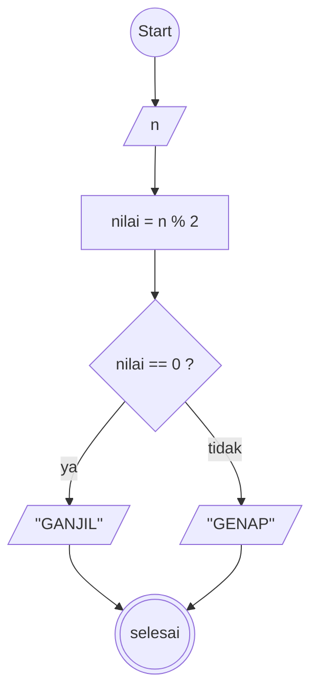
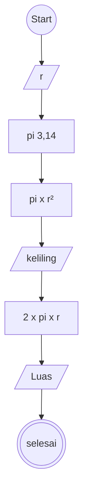

# Algoritma

## Algoritma air

1. Mulai
2. Buat variable kosong c
3. tuangkan a gelas teh ke gelas c
4. tuangkan b gelas kopi ke gelas a
5. tuangkan c gelas kosong ke gelas b kopi
6. selesai

## Algoritma Menentukan bilangan

1. Mulai
2. Masukan n
3. tentukan (nilai) sama dengan n % 2
4. jika sisa hasil bagi n sama dengan 0 maka bilangan tersebut genap
5. jika sisa hasil bagi n tidak sama dengan 0 maka bilangan tersebut ganjil
6. selesai.

## Algoritma menghitung luas dan keliling lingkaran

1. Mulai
2. masukan nilai (r)
3. nilai pi sama dengan 3,14
4. Hitung keliling dengan rumus pi x r pangkat 2
5. Hasil keliling
6. Hitung luas dengan rumus 2 x pi x r
7. Hasil luas
8. selesai

# Flowchart

## menentukan bilangan genap dan ganjil

## menghitung luas dan keliling lingkaran

# Pseudo-code

## Pseudo-code menentukan ganjil dan genap

DECLARE n : INTEGER
DECLARE nilai : INTEGER

INPUT n

nilai <- n MOD 2

IF nilai = 0 THEN
OUTPUT "GENAP"
ELSE
OUTPUT "GANJIL"
ENDIF

## menghitung keliling dan luas lingkaran
