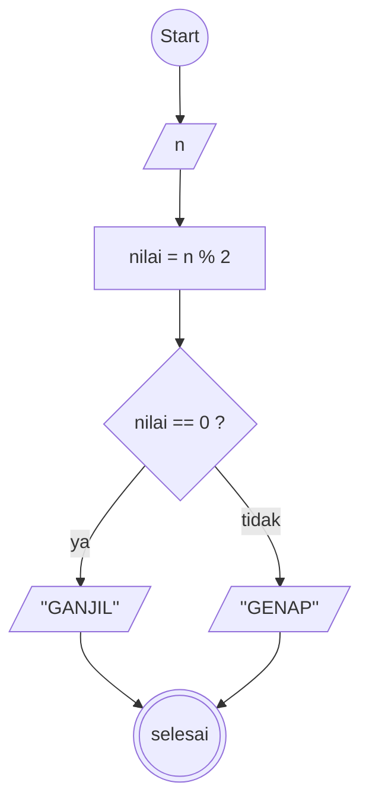

# Algoritma

# Algoritma air

1. Mulai
2. Buat variable kosong c
3. tuangkan a gelas teh ke gelas c
4. tuangkan b gelas kopi ke gelas a
5. tuangkan c gelas kosong ke gelas b kopi
6. selesai

# Algoritma Menentukan bilangan

1. Mulai
2. Nilai sama dengan (a) sama dengan 2
3. Nilai sama dengan (b) sama dengan 3
4. Hitung sisa hasil bagi bilangan dengan 2.
5. jika sisa hasil bagi (a) sama dengan 0 maka bilangan tersebut genap
6. jika sisa hasil bagi (b) tidak sama dengan 0 maka bilangan tersebut ganjil
7. selesai.

# Algoritma menghitung luas dan keliling lingkaran

1. Mulai
2. masukan nilai (r)
3. Tentukan nilai konstanta pi 22/7 atau 3,14
4. maka hitunglah keliling dengan rumus pi r pangkat 2
5. maka hitunglah luas dengan rumus 2 x pi x r
6. selesai

# simbol flowchart

# Flowchart

