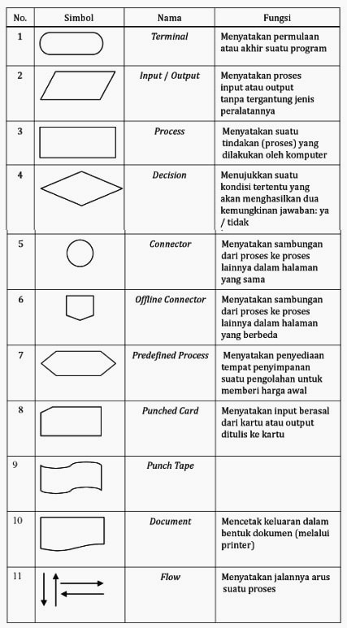
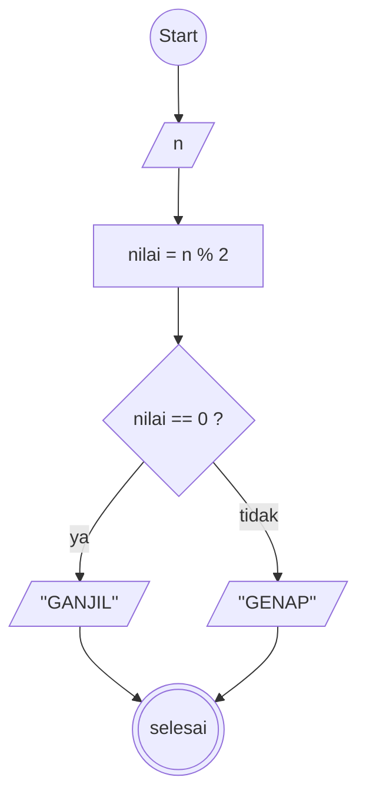
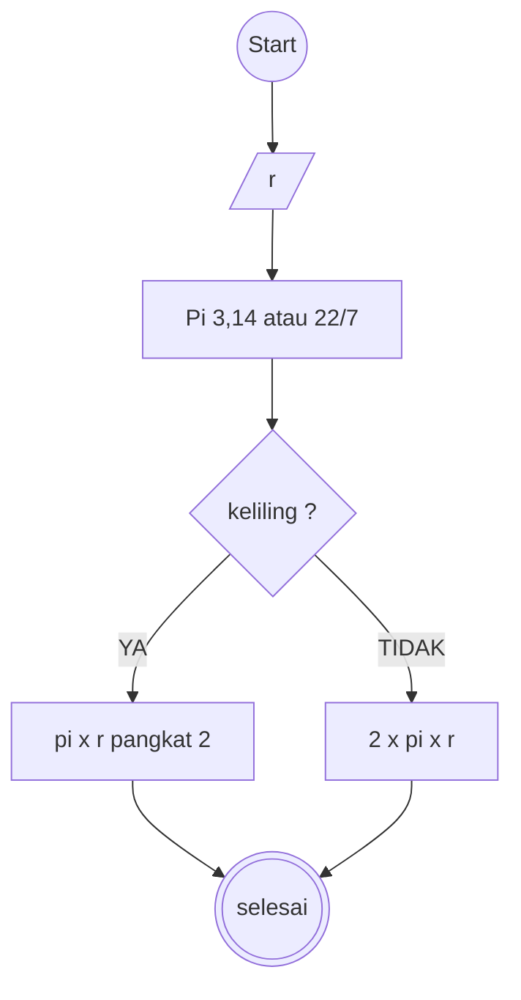

# Algoritma

# Algoritma air

1. Mulai
2. Buat variable kosong c
3. tuangkan a gelas teh ke gelas c
4. tuangkan b gelas kopi ke gelas a
5. tuangkan c gelas kosong ke gelas b kopi
6. selesai

# Algoritma Menentukan bilangan

1. Mulai
2. Masukan Nilai n
3. Hitung hasil sisa bagi dengan 2
4. jika sisa hasil bagi n sama dengan 0 maka bilangan tersebut genap
5. jika sisa hasil bagi n tidak sama dengan 0 maka bilangan tersebut ganjil
6. selesai.

# Algoritma menghitung luas dan keliling lingkaran

1. Mulai
2. masukan nilai (r)
3. Tentukan nilai konstanta pi 22/7 atau 3,14
4. jika keliling maka hitung sesuai dengan rumus keliling
5. rumus keliling dengan rumus pi r pangkat 2
6. rumus luas dengan rumus 2 x pi x r
7. selesai

# simbol flowchart

# Flowchart

# menentukan bilangan genap dan ganjil

# menghitung luas dan keliling lingkaran

